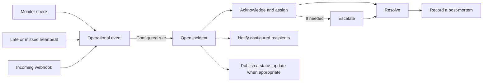

<h1 align="center">🛡️ SpectraEYE</h1>

<strong>Service Monitoring, Incident Management &amp; Status Communication</strong>

  <a href="https://eye.spectraeye.app/">Open SpectraEYE</a> ·
  <a href="#key-features">Explore features</a> ·
  <a href="#getting-started">Getting started</a>

SpectraEYE gives operations teams one workspace to monitor services and scheduled jobs, coordinate incident response, and share service status with customers. Each organisation manages its own checks, responders, integrations, and public status pages.

- ✨ [Key features](#key-features)
- 🔄 [From detection to resolution](#from-detection-to-resolution)
- 🚀 [Getting started](#getting-started)
- 📚 [Tenant Help and API](#tenant-help-and-api)

## Key features

### 📊 Dashboard and reports

- **Dashboard** brings together monitor and heartbeat status, open incidents, current on-call coverage, planned maintenance, and recent activity. Select a date in the health calendar to investigate events, and rearrange cards and widgets to suit your workflow.
- **Reports** brings together uptime, response times, heartbeat success, incident trends, status page traffic, on-call shifts, and notification activity. Search for widgets, refresh their data, and save a layout with the charts and tables you use.
- **Command palette** opens with **Ctrl+K** or **⌘K**. Search for pages and organisation resources available to your account.

### 🛰️ Monitoring and heartbeats

- **Monitors** check HTTP availability, expected response codes, keyword presence or absence, and host reachability via ping. Configure check intervals, grace and recovery periods, and certificate expiry warnings for supported URL checks.
- **Heartbeats** detect late or missed runs of scheduled jobs and other processes that report back. Use a repeating interval or a daily, weekly, or monthly schedule, with a grace period for normal timing variation.
- **Diagnostics and maintenance** let you filter logs, compare charts around a failure, and export stored results to Excel or PDF. Schedule recurring maintenance windows or pause a check when planned work affects it.

### 🚨 Incident response

- **Triage** incidents opened manually, by monitoring rules, or by incoming webhooks. Filter by status, review the linked resource, and follow incidents you need to track.
- **Coordinate the response** by acknowledging, assigning, and escalating incidents. Select on-call responders, teams, or individual recipients, and use the timeline to record decisions, comments, and attachments.
- **Resolve and review** incidents with a recorded status change and an optional post-mortem. Where configured, responders can acknowledge or resolve an incident by replying to its notification email.

### 🗓️ On-call scheduling

- **Coverage and rotations** show who is on call now and who is next. Plan manual shifts or recurring rotations in a schedule's time zone, and use temporary overrides for coverage changes.
- **Swaps and handoffs** let eligible responders request and approve or decline shift swaps, then pass context to the next responder with dated handoff notes.
- **Calendars and analytics** provide iCalendar exports and Webcal subscriptions where available. Review shifts, hours, weekend coverage, and overrides by period or person, with CSV export for schedule analytics.

### 🌐 Public status pages

- **Branded pages** organise services into sections and components linked to monitors or heartbeats. Set the theme, layout, logo, and navigation, then preview and publish the public URL.
- **Service updates** include announcements, incident reports with follow-up updates, and scheduled maintenance. Select affected components and choose whether to notify subscribers. Available embeds bring status, announcements, or maintenance badges to other sites.
- **Email subscriptions** let visitors verify their email, choose page or component preferences, and unsubscribe. Users with edit access can review, invite, or remove subscribers.

### 🔌 Integrations and notifications

- **Incoming webhooks** accept events from sources such as Grafana, Prometheus or Alertmanager, Zabbix, Datadog, and Checkmk, as well as generic integrations.
- **Outgoing integrations** send selected events to Slack, Microsoft Teams, Discord, Webex, Rocket.Chat, and Telegram. Group integration cards, choose which events to send, and test the saved configuration where supported.
- **Alert delivery** uses configured email, SMS, or voice channels. Test alerts help confirm delivery before relying on a route. Use the in-app notification inbox to open related records and manage read and unread items.

### 👥 Organisation and account

- **Organisation settings** cover branding, users, teams, planned application maintenance, and daily summaries. Administrators can manage user activation, account recovery, and MFA requirements where permitted.
- **Role-based access** lets an organisation owner manage organisation settings and API tokens, give administrators operational access, and assign **Dashboard** or module-specific **View** and **Full** roles. Available actions depend on the role and the resource.
- **Personal profile and security** include language and time zone preferences, an editable profile, password recovery, passkeys, and active session management. Account policy determines which MFA methods and recovery options are available.

### 💬 Collaboration and support

- **Chat** supports organisation-wide, team, and private conversations with replies, reactions, and file attachments. Share a profile or scratch note from its available actions.
- **Scratch Notes** let you organise notes with tags, set reminders, and share notes with selected teammates.
- **Support Inbox** lets you submit an issue with supporting files, track its status, and reply in the same thread. When a feedback survey appears, you can respond or use its reminder and dismissal options.

## From detection to resolution

Teams can use the incident timeline for internal coordination and publish customer-facing updates through a status page.

## Getting started

1. Sign in with your organisation account. If your deployment offers registration, use the **Register** option on the sign-in page.
2. Create a **Monitor** for an endpoint or a **Heartbeat** for a scheduled job. Check that the first result appears in its history.
3. Set up the relevant alert channels and **On-Call** coverage. Where a test option is available, use it to check delivery to the intended recipients.
4. Create and publish a **Status Page** if your audience needs a public view of service health.

Available modules and actions depend on your organisation role and the configuration of the deployment. [Open SpectraEYE](https://eye.spectraeye.app/)

## Tenant Help and API

Open **Help** after signing in for numbered chapters, full-text search, and interactive diagrams that walk through tenant workflows. [Open the tenant handbook](https://eye.spectraeye.app/help)

Use the tenant REST API to work with monitors, heartbeats, incidents, status pages, and on-call schedules. Users with API documentation access can browse operation parameters, request examples, responses, and authentication requirements. Organisation owners can create and revoke tokens for approved automation. [Open the API documentation](https://eye.spectraeye.app/api/docs)

  <strong>Built with ❤️ by the SpectraEYE Team</strong>

