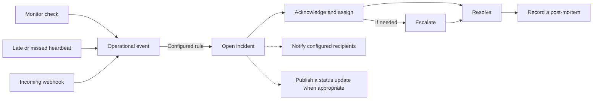

<h1 align="center">🛡️ SpectraEYE</h1>

<strong>Service Monitoring, Incident Management &amp; Status Communication</strong>

  <a href="https://eye.spectraeye.app/">Open SpectraEYE</a> ·
  <a href="#key-features">Explore features</a> ·
  <a href="#getting-started">Getting started</a>

SpectraEYE gives operations teams one workspace to monitor services and scheduled jobs, coordinate incident response, and share service status with customers.

- [Key features](#key-features)
- [From detection to resolution](#from-detection-to-resolution)
- [Architecture overview](#architecture-overview)
- [Getting started](#getting-started)
- [Tenant Help and API](#tenant-help-and-api)

## Key features

### Monitoring and heartbeats

- **Monitors** actively check HTTP availability, expected response codes, page content and host reachability via ping. Check history and charts help you investigate failures and response times. Export monitor data to Excel or PDF.
- **Heartbeats** track scheduled jobs and other processes that report back after running. Set an expected interval and grace period, inspect received signals, and export heartbeat history to Excel or PDF.
- **Maintenance and incident rules** let you schedule maintenance windows and configure when monitor or heartbeat events should raise or resolve an incident.

### Incidents and on-call

- **Incidents** can be opened manually or created from configured monitoring rules or incoming webhooks. Acknowledge, assign, escalate, and resolve incidents. Record comments, attachments, and post-mortems, and follow incidents to keep track of updates.
- **Incident timeline** brings changes, assignments, and responder updates together. Acknowledgment and resolution via email reply are available where configured.
- **On-Call** shows current coverage and upcoming shifts. Manage rotations, overrides, shift-swap requests, and handoff notes. Review schedule analytics and export schedules.

### Public status pages

- **Status pages** communicate service health through branded pages with sections, components, and links. Link a component to a monitor or heartbeat when you want its status to reflect monitoring data.
- **Announcements, status reports, and scheduled maintenance** let you publish updates and show which components are affected. Control when the page and its updates become public.
- **Email subscriptions** let visitors verify their email and manage subscriptions and component preferences. The tenant workspace includes subscriber management, and Reports can show status page traffic.

### Integrations and notifications

- **Incoming webhooks** accept events from sources such as Grafana, Prometheus or Alertmanager, Zabbix, Datadog, and Checkmk, as well as generic integrations.
- **Outgoing integrations** can send selected events to Slack, Microsoft Teams, Discord, Webex, Rocket.Chat, and Telegram. Test delivery from the integration workspace.
- **Notifications** can be delivered in the app or by email, SMS, and voice where configured. Incident reminders and organisation summaries help teams keep track of work that needs attention.

### Workspace, access, and support

- **Dashboard and Reports** bring together operational activity and configurable reporting widgets. The command palette helps you find pages and resources available to your account.
- **Collaboration** includes organisation-wide, team, and private chat, reactions, and scratch notes with reminders.
- **Organisation configuration** covers organisation details, users, teams, role-based permissions, maintenance, summary settings, and API tokens for authorised users.
- **Account and profile** tools include profile editing, password recovery, session management, and the authentication methods available to your account, such as authenticator apps or passkeys.
- **Support inbox** lets you report issues, follow tickets, and reply within the application.

## From detection to resolution

Teams can use the incident timeline for internal coordination and publish customer-facing updates through a status page.

## Architecture overview

The browser workspaces use React and TypeScript. The PHP backend serves the application and REST API, enforces organisation permissions, and persists workspace data in MySQL. Scheduled checks evaluate monitors and heartbeat deadlines. A background worker delivers queued notifications through the configured channels. Published status pages provide a separate visitor view.

## Getting started

1. Sign in with your organisation account. If your deployment offers registration, use the **Register** option on the sign-in page.
2. Create a **Monitor** for an endpoint or a **Heartbeat** for a scheduled job. Check that the first result appears in its history.
3. Set up the relevant alert channels and **On-Call** coverage. Where a test option is available, use it to check delivery to the intended recipients.
4. Create and publish a **Status Page** if your audience needs a public view of service health.

Available modules and actions depend on your organisation role and the configuration of the deployment. [Open SpectraEYE](https://eye.spectraeye.app/)

## Tenant Help and API

Open **Help** after signing in for numbered chapters, full-content search, and diagrams that explain tenant workflows. [Open the tenant handbook](https://eye.spectraeye.app/help)

Use the REST API to work with monitors, heartbeats, incidents, status pages, and on-call schedules. The API documentation describes the supported operations and authentication. [Open the API documentation](https://eye.spectraeye.app/api/docs)

  <strong>Built with ❤️ by the SpectraEYE Team</strong>

